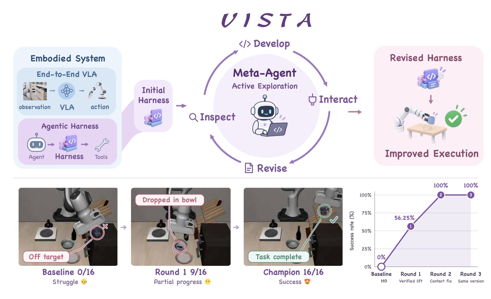
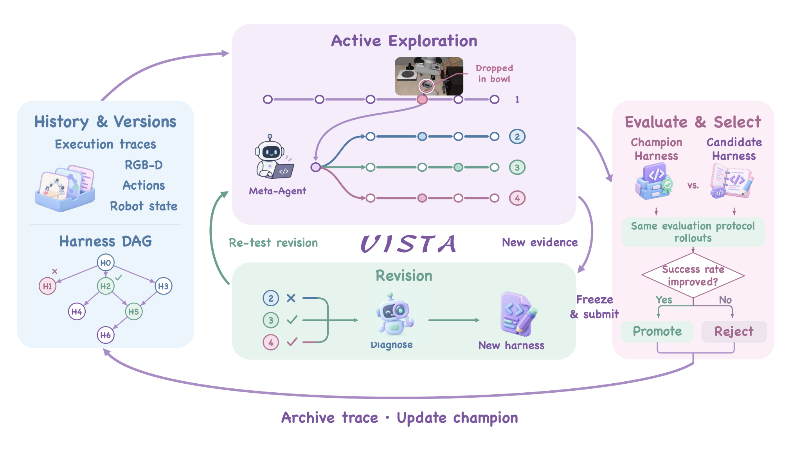
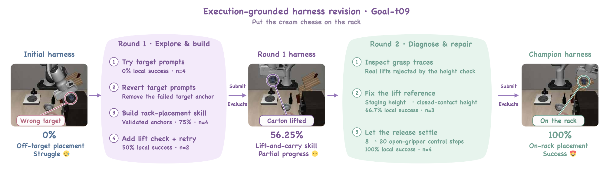
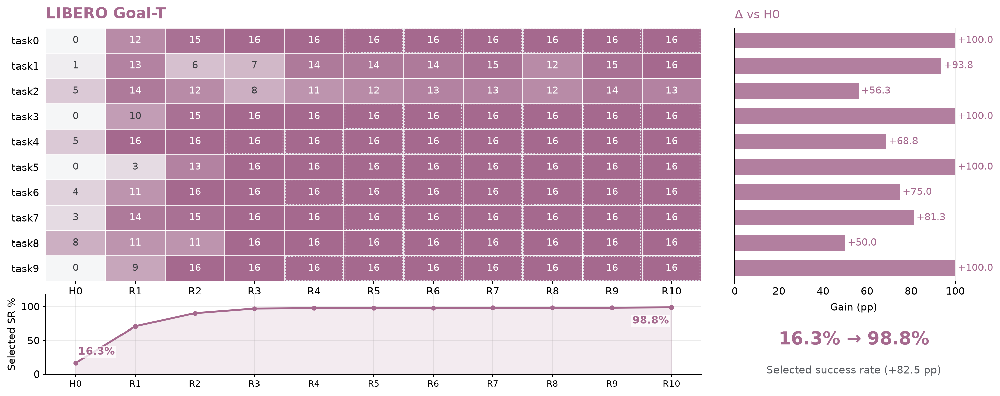
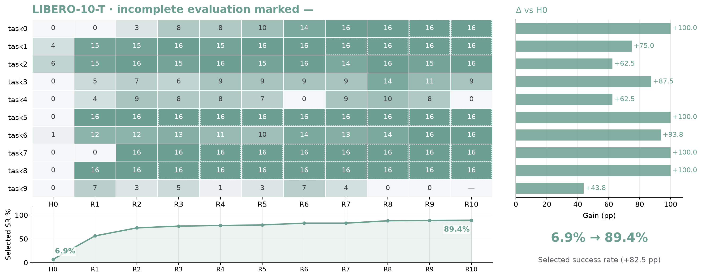

- 论文：VISTA: Active Exploration for Self-Improvement in Embodied Agents

- 作者：Zhang Zhang、Shengjun Zhang、Simin Huang、Min Chen、Chong Xia、Xin Fei、Yueqi Duan

- 机构：Tsinghua University、National University of Singapore

- 版本：arXiv 2610.35051v1（2026-10-26，cs.RO）

- 官方原文：https://arxiv.org/abs/2610.35051

- arXiv HTML：https://arxiv.org/html/2610.35051v1

- 项目页：https://agenticei.github.io/VISTA-page/（HTTP 200）

- 代码：https://github.com/AgenticEI/VISTA（HTTP 200；当前仅发布 LIBERO-Pro 开发运行时、初始 harness 与部分工具，RoboCasa/RoboTwin 集成、演化后的 harness 及实验记录未随仓库发布）

- 来源：用户指定（非 Hugging Face Daily 批次）；精读归档日期：2026-11-02

标签：Agent Harness、Embodied AI、Robot Manipulation、Self-Improvement、Benchmark Evaluation。

## 0. 一句话结论

VISTA 把机器人智能体的 harness（执行壳）——指令、可执行技能、策略钩子（policy hooks）、持久过程记忆（persistent procedural memory）与工具依赖——当成可版本化、可执行的程序，让一个元智能体（meta-agent）在私有仿真会话中主动做诊断实验，再把冻结的候选放回完整开发矩阵上，只有严格优于现任才替换；在 LIBERO-Pro、RoboCasa365、RoboTwin 三个仿真基准上，从各自初始 harness 出发分别把成功率从 17.5% 提到 95.0%、16.4%/4.7% 提到 24.2%/13.3%、48.5% 提到 74.0%。这些数字支持“执行级 harness 演化在仿真中能积累有效机制”，但最终指标是逐任务冠军（per-task champion）在各自声明的开发矩阵上（LIBERO-Pro/RoboCasa 为 8 个场景种子 × 2 次重复，RoboTwin 为 4 个随机场景 × 2 次重复）选出来的，没有留出集（held-out set）、真机或预算对齐的强基线，因此还不足以支持“通用具身自我改进”或真实环境泛化的结论。

## 1. 论文具体想解决什么问题？

长时程、多阶段机器人操作是端到端策略的老大难：误差沿轨迹累积（compounding errors）、扰动下分布外（out-of-distribution, OOD）泛化差、拟合多模态长尾动作分布所需样本量过大（§1）。一条主流补救路线是把 LLM（大语言模型）规划器、VLA（视觉-语言-动作模型）和工具组合成具身智能体系统：高层负责语义分解、主动感知和闭环纠错，低层由 VLA 执行原子动作。作者强调，这类系统的表现不只取决于预训练模型权重，还取决于包在模型外面的 harness——它决定智能体看到什么、能调用哪些技能、如何组织请求与反馈、跨回合保留哪些过程知识（§1、§3）。

现有的 harness 改进大多来自人工设计的代码生成、技能库和记忆机制；更自动一些的做法（如 Reflexion 式事后反思）把已经跑完的 rollout（执行轨迹）当日志，离线总结失败原因，再改提示、技能或记忆。作者指出的具体缺口是：这些记录不一定包含检验某个失败解释所需的观察或干预。例如论文在 Goal-t09 中遇到的失败：日志显示“抓取失败”，却没有说明夹爪是否真正接触、抬升判据是否把 staging（暂存）高度误当成闭合接触高度；要区分这些假设，必须回到环境里做新实验。于是现有方法容易产生“看起来合理、但没有在新具身交互中检验”的 harness 更新（§1、§3.3）。

本文要验证的核心假设可以拆成两句：第一，如果把 harness 做成可执行、可版本化的包，并允许编码智能体在提交前主动开启私有仿真会话、探查执行状态、调用公开感知/控制能力，那么它获得的新证据能转化为更好的 harness；第二，如果在提交后用冻结候选在完整开发矩阵上重新评估、并只接受严格提升，那么这种“先实验、再提交、再验证”的循环会比被动反思更省 token、更稳地积累机制（§3、§4.3）。

需要区分三层问题：长时程操作本身是领域早已存在的一般问题；“rollout 日志不足以检验失败解释”是本文强调的观察；“在固定模型参数、固定能力接口和固定评估规则下，如何演化 harness”是本文实际解决的子问题。论文用主动 vs 被动的四任务消融间接支持第一句，但没有直接证明“日志一定不够”；严格选择规则本身也没有与“总是接受”等替代规则做对照。更准确的说法是：作者观察到了被动反思在特定任务上的样本效率劣势，并给出了一个机制解释，尚未把“日志不足”或“严格选择”作为独立因果变量隔离出来。

## 2. 创新点是什么？

真正的技术增量不是新的 VLA 或新的训练算法，而是把 harness 从一次性人工设计物变成可执行、可版本化、可被元智能体实验性修改的对象。按贡献可拆成三项方法侧创新和一项实证范围。

第一，可演化的执行壳与 Harness DAG（有向无环图）。论文把 harness 定义成五元组 H=(I,S,P,M,D)：I 是模型可见指令，S 是技能描述与可执行实现，P 是请求构造、工具选择与反馈处理的策略钩子，M 是持久过程记忆，D 是工具绑定与能力依赖；模型参数、能力接口和评估规则固定（§3.1）。每个冻结版本是一个 Git commit，父链接定义谱系，分支保留替代方向，显式合并组合历史，执行记录与开发笔记挂在对应版本上；被拒绝的候选仍可被后续迭代选为开发基座（§3.1、Appendix A.3）。与 Meta-Harness、Reflexion 等最接近的工作相比，这里优化的不是提示或记忆片段，而是可执行包及其证据谱系；但 Git 版本、分支、合并都是已有工程组件，新的部分是它们与具身执行证据的绑定方式（详见 §3.1、§4.3）。

第二，主动诊断探索（active diagnostic exploration）。元智能体可以在提交候选前，从冻结的 harness 快照启动私有仿真会话，检查当前执行状态，调用公开的感知或控制能力来检验某个具体假设；这些交互只作为诊断证据，不修改正式评估流程（§3.3）。与被动反思的区别是证据来源：被动方法只能重读已有 rollout，主动方法能生成新的观察和干预；这是本文最核心的“研究思想”增量，但它是否在所有任务上都比被动方法更省资源，只在一个四任务、两轮的消融里得到支持（§4.3、Table 4）。

第三，冻结候选与严格提升选择（autonomous validation and selection）。提交后，宿主（host）在声明的开发矩阵上，用 M 个任务初始化和每个初始化 R 次重复，重新执行冻结候选；候选与现任使用匹配的任务初始化、重复设置、模型配置和执行上限；只有候选的经验成功率严格高于现任才替换，平局保留现任，匹配的现任评估可以复用（§3.4）。这相当于把“测试时搜索”从动作层/提示层搬到可执行 harness 层，并用宿主控制的评估把开发与验收隔开；它不训练任何模型参数（§3、§4）。Goal-t08 的轨迹显示，一个被拒绝的停止规则候选没有替换现任，后续分支才达到 100%，这说明规则至少在该案例中防止了回退（§4.4、Fig. 4(b)）；但论文没有把“严格选择”与“总是接受”“接受最后一个”等替代规则做对照，因此其必要性仍属设计主张而非被消融证明的结论。

此外，论文在三个仿真基准上做了跨基准实证：LIBERO-Pro 八个设置、RoboCasa365 Composite Seen/Unseen、RoboTwin 50 任务，并在附录给出逐任务表和逐轮热图（§4、Appendix B）。这不是提出新基准，而是用已有基准检验 harness 演化的可迁移性；标签上对应 Benchmark Evaluation 而不是 Benchmark Construction。

## 3. 作者如何解决？

直觉上，VISTA 把“学习”从模型参数移到执行壳：模型不变，变的是模型周围的程序。只要能把失败定位到某个决策或某段物理执行，并把修复写成可执行技能、检查或协调逻辑，就能在不重新训练 VLA 的情况下改变行为。为了让这种修改不变成“拍脑袋改提示”，作者给元智能体配了三样东西：一份带证据的版本历史、一个可以主动做实验的私有仿真会话、以及一个宿主控制的冻结评估与严格选择规则。图 1 概括了这个闭环：从初始 harness 出发，元智能体读取执行证据、提出修订、在环境中主动试验，再把修订后的 harness 交给正式评估；下方的示例序列显示，同一个任务可以从 0/16 逐步走到 16/16，而模型权重始终没有变。

**图 1**（论文 Fig. 1）：这张图要说明的不是“某个模块更强”，而是改进对象变了。左侧把端到端 VLA 与“智能体 + harness”并列：前者直接把观察映射成动作，后者在模型外面多了一层可编辑的技能、工具和协调逻辑；中间是元智能体的 inspect → develop → revise → interact 循环，它读的是历史执行证据，做的是对新证据的主动采集；右侧“revised harness → improved execution”表示被改写的是可执行程序，而不是模型参数。底部的示例序列把这一机制落到一个具体任务：初始 harness 把目标认错，第一轮做出部分进展但仍把纸盒丢进碗里，冠军 harness 才把纸盒放到架子上；这条 0/16 → 9/16 → 16/16 的曲线是“执行级修订可以累积”的直观证据，但它只是单个成功案例，不是平均性能。

一次完整的开发迭代可以按下面的顺序走。

第一步，定义输入与固定边界。在线智能体由语言模型规划器 Lθ、VLA πφ 和公开能力接口 C 组成；C 暴露观察、感知、策略推理和有界机器人控制。harness 是 H=(I,S,P,M,D)，它可以改变在线智能体可用的操作以及这些操作如何被协调，但不能改变 Lθ/πφ 的权重、C 的接口和评估规则（§3.1）。在 LIBERO-Pro 上，初始 H0 是一个最小包：观察 → 一次原始 VLA 动作批次 → 再观察/推理，只绑定文件、图像显示、结束等原生工具和 observe/vla_step 两个技能，没有任务配方、进阶机器人工具或恢复例程（仓库 harnesses/libero_pro_h0_min/README.md）；在 RoboCasa365 和 RoboTwin 上，H0 则是把 HarnessVLA 的参考实现适配到对应基准，保留其提示、策略钩子、工具接口和记忆（§4.1）。这个区别很重要：三个基准的起点强弱不同，后面的数字不能直接横比。

第二步，跑外层循环。宿主先在开发矩阵（development matrix）D_dev 上评估 H0，令现任 H*←H0；然后每一轮从 DAG 中选一个保留版本作为开发基座（默认是现任，也可以选之前被拒绝的候选），元智能体在预算内开发一个候选；候选被冻结后，宿主在 D_dev 上用新鲜 episode 重新评估；只有严格提升才更新现任；无论是否晋升，候选及其证据都写入 DAG；循环直到预算耗尽或停止规则满足（Algorithm 1）。早停时，同一个被选中的包要连续通过规定次数的完美正式评估；确认轮只重新评估、不再开发（§3.4）。图 2 把这个外层循环和内部开发循环画在一起：左侧是历史与版本，上方是主动探索，下方是修订，右侧是评估与选择，底部把证据归档回 DAG。

**图 2**（论文 Fig. 2）：这张 pipeline 的关键是“两个循环 + 一条隔离带”。外圈从 History & Versions 出发：DAG 里存着 H0 到 H6 这样的不可变版本，执行轨迹、RGB-D、动作和机器人状态挂在版本上；元智能体默认从现任开始，也可以回到更早的分支。内圈是 Active Exploration → Revision → Re-test：元智能体先诊断（例如图中“Dropped in bowl”的失败），再改代码得到新 harness，再用新的证据重测；这些内部测试只是开发证据。右侧 Evaluate & Select 是隔离带：冻结候选后，宿主用同一套评估协议把候选与冠军对比，成功率高才晋升（Promote），否则拒绝（Reject）；被拒绝的版本不会消失，而是留在历史里供后续分支复用。底部“Archive trace · Update champion”把评估记录写回 DAG，形成下一轮的起点。读者应从中理解：VISTA 不是让模型在测试时“多想几步”，而是让一个编码智能体在开发阶段做实验，再把验证过的程序冻结给在线智能体执行。

第三步，元智能体在内部循环里选操作。它有一组开发侧工具：历史检查（history_summary、history_episodes、history_decisions、history_frame、inspect_decision、inspect_harness 等）、包开发（编码智能体的文件工具、select_parent、budget、submit）、主动诊断（live_start、live_decision、live_observe、live_capability、live_reply、live_close）和自主测试（evaluate、evaluation_status）（Appendix A.2、Table A1）。它可以选择先看哪条失败轨迹、调用哪个公开能力、在哪个决策边界接管、是否请求一次中间版本的自主测试；这些选择由模型决定，但“冻结包、启动模拟器、记录轨迹、执行最终选择”由宿主控制（Appendix A.1）。这里有一个容易忽略的隔离设计：开发侧工具和在线智能体的运行时工具是两套表面；元智能体在 live（实时）会话里调用某个能力，不代表正式评估时在线智能体也能调用它（Appendix A.2）。此外，live 场景不会随着工作区热切换；改了代码要测，必须用新的冻结包重新开会话；live 观察只作为诊断证据，不会被悄悄塞进规划器的上下文（Appendix A.1）。

第四步，把证据转成修订。每条开发记录都绑定一个冻结的 harness 版本和精确执行条件（任务初始化、重复、随机性、执行模式）；一条轨迹把规划器决策、工具调用、机器人动作、图像和状态对齐，使元智能体能把“总体失败”定位到某个决策或某段物理执行区间（§3.2）。然后它形成一个具体假设，修改受影响的组件——指令、观察处理、技能终止条件、协调逻辑等——并把新版本及支持证据保留下来。若已有轨迹不足以区分假设，才进入主动探索（§3.2、§3.3）。仓库里的 evolve-harness 技能把这一流程写成开发协议：先对齐失败决策的真实请求、工具参数、原始返回和物理前后帧；再写可证伪的操作假设；然后做最小干预；内部验证先用 2–4 个代表性种子、每种子一次重复，确认机制后再扩大；正式晋升只看宿主在完整矩阵上的官方成功（meta_harness/assets/skills/evolve-harness/SKILL.md）。这解释了为什么“主动”不是随便多跑几次，而是围绕一个可证伪假设去取样。

第五步，用选择规则决定是否替换。设开发矩阵有 M 个任务初始化和每个初始化 R 次重复，候选 H 的经验成功率为

$$
\hat J_{\mathrm{dev}}(H)=\frac{1}{MR}\sum_{i=1}^{M}\sum_{r=1}^{R} S(H;x_i,\xi_{i,r}),
$$

其中 S∈{0,1} 是官方自主任务成功。选择规则是：若 $\hat J_{\mathrm{dev}}(\tilde H_k)>\hat J_{\mathrm{dev}}(H_k^\star)$ 则 $H_{k+1}^\star=\tilde H_k$，否则保留 $H_k^\star$；平局保留现任（§3.4，Eq. 3）。候选与现任必须使用匹配的任务初始化、重复设置、模型配置和执行上限；匹配的现任评估可以复用；只有完整、可比较的有效自主结果矩阵才允许选择（§3.4）。这套规则把“候选是否更好”定义成一个宿主可复核的经验比较，而不是元智能体的自我声明；官方成功是宿主证据，不是规划器的 finish 声明，基础设施错误也不算任务失败（仓库 evolve-harness 技能）。但要注意：它比较的是同一组任务初始化上的经验成功率，不是留出集上的泛化性能；这是后面第一项质疑的根源。

第六步，输出与是否训练。VISTA 不训练任何模型参数；它输出的是每个任务被选中的 harness 包（代码、技能、提示、记忆、依赖声明）及其证据谱系。在线智能体在评估时仍然闭环执行：harness 代码和持久知识冻结，但 episode 内的状态和动作依赖实时观察（§3.1）。因此它是一种免训练（training-free）的系统级优化：把“学习”放在开发阶段的代码与证据循环里，而不是放在权重更新里。

## 4. 解决得怎么样？

### 4.1 实验设置

论文在三个仿真基准上评估。LIBERO-Pro 包含 Spatial、Object、Goal、LIBERO-10 四个套件，每个套件在指令重定向（T）和位置交换（S）两种扰动下测试；每个套件 10 个任务，每个任务 8 个场景种子（scene seed）、每种子 2 次重复（repetition），共 16 个 episode（回合）/任务、160 个 episode/套件（§4.1）。RoboCasa365 取 Composite Seen 和 Composite Unseen 两类，每类 16 个任务，8 个场景种子 × 2 次重复，共 256 个 episode/类（§4.1）。RoboTwin 评估 50 个任务，4 个随机场景 × 2 次重复，共 400 个 episode（§4.1）。

基础策略按基准分开：LIBERO-Pro 用 π0.5，RoboCasa365 用 RLDX-1，RoboTwin 用 LingBot-VLA；在线规划器统一用 GPT-5.6 Sol，元智能体用 Codex 和 GPT-6（§4.1）。仓库记录的模型标识更具体：LIBERO-Pro 与 RoboCasa365 的元模型是 gpt-6-astra，RoboTwin 是 gpt-6.1-sol；规划器都是 openai-responses:gpt-5.6-sol（docs/experiment-models.json）。基线包括 OpenVLA、π0、π0.5、RLDX-1、LingBot-VLA 和 HarnessVLA；LIBERO-Pro 的 H0 是最小观察接口 + 冻结 VLA，RoboCasa365/RoboTwin 的 H0 由 HarnessVLA 参考实现适配而来（§4.1）。评价指标是任务成功率（success rate），差值用百分点（percentage points）表示；论文没有报告执行步数、碰撞/安全违规、恢复行为质量或人工干预次数。

预算方面，候选与现任使用匹配的任务初始化、重复、模型配置和执行上限，这一点是受控的；但 VISTA 与外部基线之间没有预算对齐：VISTA 的规划器和元智能体是强闭源模型，元智能体还会消耗大量 Meta tokens（元智能体 token，含缓存/非缓存输入、输出和子智能体用量），而论文没有说明 HarnessVLA 等基线是否有同等的开发预算（§4.1、§4.3、Table 4）。主实验（Table 1–3）回答“从各自 H0 出发能提升多少”；消融（ablation，Table 4）回答“主动探索是否比被动反思好”；附录（Tables A2–A4、Fig. A2）回答“逐任务和逐轮的变化长什么样”；Appendix A 则说明基础设施、工具表面和 Git 历史。需要再次强调：三个基准的初始 harness 和基础策略不同，跨基准的数字不能直接横比。

### 4.2 关键结果

先看主表。Table 1 的 LIBERO-Pro 平均成功率从 H0 的 17.5% 升到 95.0%，提高 77.5 个百分点；HarnessVLA 是 61.1%，π0.5 是 11.0%。Table 2 的 RoboCasa365 从 16.4% 升到 24.2%（Seen，+7.8），从 4.7% 升到 13.3%（Unseen，+8.6）；作为参照，RLDX-1 是 17.4%/6.8%，π0.5 是 6.8%/0.9%。Table 3 的 RoboTwin 从 48.5% 升到 74.0%（+25.5）；作为参照，LingBot-VLA 是 50.4%，HarnessVLA 是 58.0%，π0.5 是 47.9%。这些数字可以整理成下表，但读表时必须带上“基础策略不同、初始 harness 不同”的限定。

| 基准（基础策略） | H0 | VISTA | Δ over H0 | 其他参照 |
|---|---:|---:|---:|---|
| LIBERO-Pro（π0.5） | 17.5 | 95.0 | +77.5 | HarnessVLA 61.1；π0.5 11.0 |
| RoboCasa365 Seen（RLDX-1） | 16.4 | 24.2 | +7.8 | RLDX-1 17.4；π0.5 6.8 |
| RoboCasa365 Unseen（RLDX-1） | 4.7 | 13.3 | +8.6 | RLDX-1 6.8；π0.5 0.9 |
| RoboTwin（LingBot-VLA） | 48.5 | 74.0 | +25.5 | HarnessVLA 58.0；LingBot-VLA 50.4；π0.5 47.9 |

有几个细节比平均值更重要。第一，LIBERO-Pro 的提升在八个设置上并不均匀：Goal-S 从 4.4% 到 97.5%（+93.1）最大，Object-T 从 49.0% 到 100.0%（+51.0）最小；LIBERO-10-S 从 0.0% 到 76.9%，但 S3 仍是 0.0%、S8 只有 18.8%（Table 1、Table A3）。第二，LIBERO-10-T 的 T4 和 T9 分别只有 63.0% 和 44.0%，虽然相对 H0 的 0.0% 提升很大，但说明长时程尾部任务远未解决（Table A2、Appendix B.1）。第三，RoboCasa365 的绝对水平仍低：Unseen 13.3% 意味着大部分未见场景仍然失败；Seen 的 24.2% 也远低于“可用”的水平，而且 H0 本身低于原始 RLDX-1（16.4 vs 17.4；4.7 vs 6.8），说明“把 HarnessVLA 适配到 RLDX-1”这一步并没有比原始策略更强（Table 2、Table A4）。Seen 和 Unseen 各有 5 个任务没有提升，例如 Seen 的 GetToastedBread 0.0→0.0、SearingMeat 0.0→0.0，Unseen 的 ArrangeTea 0.0→0.0、SeparateFreezerRack 0.0→0.0（Table A4）。第四，RoboTwin 的 H0 48.5% 低于 HarnessVLA 的 58.0%，VISTA 的 74.0% 比 HarnessVLA 高 16.0 个百分点，但这也意味着“从 H0 到 VISTA”的 +25.5 中有相当一部分是在弥补一个比参考实现更弱的起点（Table 3）。

论文正文称演化后的 harness 在 T 设置上达到 97.0%、S 设置上达到 93.4%（§4.2）。按 Table 1 的四个 T 列直接平均是 (98.0+100.0+99.0+89.0)/4=96.5，即使按附录逐任务计数池化也只有约 96.6，仍不是 97.0；S 列平均是 (100.0+99.4+97.5+76.9)/4=93.45，正文报告 93.4，严格四舍五入会得到 93.5，说明舍入规则也未说明。T 均值的 0.4–0.5 个百分点差异不影响主结论，但这是一个正文与表格对不上的真实口径问题；附录 Table A2 的 LIBERO-10-T Δ（+83.0）与 Table 1 的 +82.0 则是“逐任务 Δ 平均后取整”与“先取整套件均值再相减”的差异，Table A2 与 Fig. A2 的 0–0.4 尾数差异也只是整数/一位小数的报告精度不同（底层计数一致），详见 §5 第五项质疑。

方差和显著性方面，论文只报告点估计，没有置信区间（confidence interval）、标准误（standard error）或显著性检验（statistical significance）。按二项分布粗算（审稿人计算，不是论文结果）：每个任务 16 个 episode，成功率 50% 时单任务标准误约 12.5 个百分点；每个套件 160 个 episode，标准误约 3–4 个百分点。也就是说，逐任务表中几个百分点的差异很可能在噪声范围内，套件级 1–2 个百分点的差异也不应被过度解读。这个计算不改变“从 17.5 到 95.0”这种量级的结论，但会影响对 RoboCasa 的 +7.8/+8.6 以及 Table 4 的 +39.1/+50.0 的精确解读。

### 4.3 机制证据

主动 vs 被动的消融是论文最直接想证明“为什么有效”的实验。Table 4 在四个 LIBERO-Goal 任务上比较两臂：被动臂保留历史检查、harness 编辑和自主候选评估，但不能开 live 场景、不能探查决策边界、不能执行诊断能力，只能从已记录 rollout 诊断；主动臂就是完整的 VISTA。第一轮，主动 +50.0 个百分点、消耗 42.2M Meta tokens，被动 +39.1、消耗 94.2M；第二轮，主动 +85.9、累计 91.6M，被动 +56.3、累计 137.7M（Table 4、§4.3）。这组数字支持“在这四个任务、这两轮预算下，主动探索用更少 token 得到更高成功率”，但它不是完整的因果分解：只有四个任务、两轮，没有去掉 DAG、去掉私有仿真探查、去掉严格选择规则的逐组件消融；两臂的 token 预算也不完全一致（被动反而用了更多 token），仓库还记录 Goal-t05 使用了不同的 provider 和 reasoning 设置、Goal-t00/Goal-t03 的前两轮被动实验早于 token-target gate（docs/experiment-models.json）。因此更稳妥的判断是：主动探索与更好的结果相关，且在这个小规模设置下更省 token；但“主动探索本身是唯一原因”尚未被干净地隔离。

个案研究提供了更具体的机制证据。Goal-t08 从 50.0% 开始，第一轮细化放置行为后到 68.75%（11/16），第二轮尝试替代停止规则但提交的候选没有超过现任，被拒绝；后来一个分支引入度量放置技能，达到 100.0%，同一冻结 harness 再评估仍是 100.0%（§4.4、论文 Fig. 4(b)）。这说明候选可以非单调，严格选择 + 最佳保留让系统不会因为一次坏提议而回退；但论文没有报告这个任务上总共提交了多少候选、拒绝率是多少，也没有比较“总是接受最后一个”会怎样。

Goal-t09 的案例更能说明“证据如何变成代码”。初始 harness 0.0%；第一轮分析失败轨迹后，要求运输前先验证抬升、在有限次抓取重试前重新分割纸盒、并加入显式的运输—释放流程，达到 56.3%（9/16）；剩余失败暴露出抬升验证的逻辑错误——抬升是相对接近位姿（approach pose）测量的，而不是相对真正抬起纸盒的闭合接触状态；第二轮把检测器改为在连续闭合接触段上测量位移、接触丢失时重置累积证据，并调整释放行为，最终达到 100.0%（16/16）（§4.4、Fig. 5）。图 3 把这个过程展开成“探索—构建”和“诊断—修复”两轮：第一轮试错目标提示、回退失败锚点、构建架子放置技能、加抬升检查与重试；第二轮检查抓取轨迹、修正抬升参考、让释放多等 8→20 个开爪控制步。它展示的是机制积累，而不是“平均提升”的统计证据；论文也只展示了这个成功案例，没有给出失败分支的汇总。

**图 3**（论文 Fig. 5）：这张图要读的是“失败证据 → 具体代码改动 → 新的物理行为”的链条。初始 harness 把奶油奶酪盒对错了目标，0% 成功；第一轮不是简单改提示，而是先试目标提示、失败后回退锚点，再构建架子放置技能、加入抬升检查与有限重试，把局部成功率推到 56.25%；第二轮通过检查抓取轨迹发现“真实的抬升被高度检查拒绝”，于是把抬升参考从暂存（staging）高度改成闭合接触高度，并让释放多等 8→20 个开爪控制步，最终 100%。图中的 0%、56.25%、100% 是正式评估的几个节点，旁边的 0% n=4、75% n=4、50% n=2、66.7% n=3、100% n=4 是开发期的局部诊断测试；两者不要混为一谈。这个案例支持“主动诊断能发现日志里看不出的判据错误”，但它是一个被选中的成功故事，不能单独证明方法在多数任务上都有效。

逐任务热图提供了另一种机制证据，也暴露了平均值的局限。图 4 是 LIBERO Goal-T 的逐任务演化：行是 10 个任务，列是 H0、R1…R10，实线格是每轮候选的 16 个 episode 成功数，虚线格是开发停止后沿用上次结果，右侧条形是保留冠军相对 H0 的增益，底部是选中的套件成功率。可以看到不同任务的进度并不同步：有的任务在前几轮就饱和，有的到很晚才提升；单个候选的分数可以上下波动，但保留冠军的曲线因为“最佳保留”而不会下降。

**图 4**（论文 Fig. A2，Goal 面板）：这张热图把“开发轮次”与“任务异质性”放在同一张表里。每一行是一个 Goal 任务，每一列是一轮开发（H0 为初始 harness，R1–R10 为后续轮次）；格子里的数字是该轮候选在 16 个 episode 中的成功数，虚线表示该任务开发停止后沿用上次的保留结果，em dash（长破折号）表示评估未完成。右侧条形是最终保留冠军相对 H0 的增益，底部曲线是套件级的选中成功率（图中为 16.3% → 98.8%）。读者应从中理解两点：第一，保留冠军的曲线单调不降，是“严格提升才替换”规则的直接结果，不代表每个候选都更好；第二，任务之间的提升节奏差异很大，套件平均会掩盖这种差异。这张图的 16.3/98.8 是底层成功计数（26/160 与 158/160）的一位小数表示；Table A2 按整数报告为 16.0/99.0，二者不是数据矛盾，而是报告精度不同。

图 5 是 LIBERO-10-T 的对应热图：长时程套件提升更慢，任务间差异更大，R10 还有一个未完成评估（em dash），而底部汇总仍有 89.4%。这两张图说明“逐任务冠军”是异质的，平均值会把尾部失败藏起来；图与表的套件值有 0–0.4 的尾数差异，来自表按整数、图保留一位小数的报告精度，底层成功计数一致；真正的口径问题是正文 T 均值 97.0 与 96.5/96.6 对不上（见 §5 第五项质疑）。

**图 5**（论文 Fig. A2，LIBERO-10 面板）：这张图补充的是长时程套件的尾部行为。LIBERO-10-T 的任务更长、阶段更多，整体提升比 Goal 慢；图中可以看到部分任务很晚才提升，R10 还有一个未完成评估（em dash），底部汇总仍显示 89.4%。它要说明的不是“平均 89.4% 很好”，而是这个平均由若干差异很大的任务组成：Table A2 里 T4 只有 63.0%、T9 只有 44.0%，这些尾部失败在套件平均中被冲淡了。对审稿人来说，这张图是“平均值掩盖长尾”的直接证据；对读者来说，它提醒我们：VISTA 的 per-task champion 并不是一个在所有任务上都稳定的通用 harness，而是每个任务各自演化的结果。

把三类证据放在一起看：主表证明“完整系统在三个仿真基准上相对各自 H0 有大提升”；Table 4 证明“在这四个 Goal 任务、这两轮预算下，主动臂比被动臂好”；Goal-t08/t09 证明“证据可以转化为具体的、可执行的修复”。但这些证据还没有回答：DAG 本身贡献多少？私有仿真会话贡献多少？严格选择规则贡献多少？如果把元智能体换成较弱模型、把 token 预算砍半，提升还剩多少？论文没有做这些消融，因此“每个设计都必要”目前是设计论证，不是实验结论。

### 4.4 成本与适用范围

成本方面，论文只报告了 Table 4 的 Meta tokens：四个 Goal 任务上，主动臂第一轮 42.2M、第二轮累计 91.6M；被动臂第一轮 94.2M、第二轮累计 137.7M（Table 4）。论文没有报告跨三个基准的总 token、总墙钟时间（wall-clock time）、GPU 小时、每个任务的开发时长、候选总数、拒绝率或失败分支统计；这些都应明确写“论文未报告”。仓库配置补充了一些实现侧数字：LIBERO-T 协议使用 8 个场景种子（1000–1007）×2 次重复、10 个并行开发轮、最多 12 次评估请求、2 次 live trial；规划器是 gpt-5.6-sol、high reasoning、最多 100 轮、单轮最多 8192 tokens、规划器超时 2400 秒、单 episode 超时 4 小时、环境步数上限 10000；元模型是 gpt-6-astra、ultra reasoning；资源池列出 8 张 GPU（configs/protocols/libero-t.json、docs/experiment-models.json）。这些是仓库配置，不是论文正文报告的成本；论文只把模型标识和启动配置指向代码仓库（§4.1）。

外部依赖方面，VISTA 依赖闭源（closed-source）的 GPT-5.6 Sol、GPT-6/GPT-6.1 和 Codex，以及 π0.5、RLDX-1、LingBot-VLA 等策略检查点；方法本身不训练权重，所以主要成本是元智能体的 token 和仿真器 rollout，而不是梯度计算。人工成本方面，LIBERO-Pro 的 H0 是作者写的最小包，RoboCasa365/RoboTwin 的 H0 是作者把 HarnessVLA 参考实现适配到各基准（§4.1）；论文没有报告这部分人工工程量，也没有报告评估期间的人工干预（评估是自主的）。存储与系统复杂度不低：要维护 Git 版本、运行记录库（run store）、轨迹/图像/状态、私有仿真会话、MCP（Model Context Protocol）工具接口和宿主评估器（Appendix A.1、A.3）。

适用范围方面，论文的所有实验都在仿真中完成，作者在 §5 明确承认没有真机验证，并计划未来在 Franka Emika 机械臂和移动操作平台上测试；真实世界的传感器噪声、执行延迟、未建模接触动力学都可能改变主动探索的收益与风险（§5 Limitations）。方法固定了模型参数、能力接口和评估规则，因此它适用于“执行壳层”的改进，不适用于需要改 VLA 权重、改感知/控制接口或改评估协议的问题。它还是逐任务开发、逐任务选择：Table A2 的 Evolved 是 per-task champion（§4.1、Table A2 caption），不是单一 harness 在全部任务上的泛化结果；因此结论应限定为“在给定任务和给定开发矩阵上，执行级演化能找到更高的成功率”，不能扩展成“VISTA 学到了一个通用机器人 harness”。

## 5. 最容易受到审稿人质疑的地方

#### 质疑：最终指标是逐任务冠军在同一开发矩阵上的成功率，既没有留出集，也不是单一通用 harness

- **原文依据**：§4.1 明确写 “VISTA develops these initial harnesses and selects a version for each task”；Table A2/A3 的 caption 写 “Evolved denotes the per-task champion after evolution”；§3.4 的选择使用开发矩阵 D_dev，Algorithm 1 第 15 行也是 “Evaluate H̃ autonomously on D_dev from fresh initializations”；LIBERO-Pro 的矩阵是每个任务 8 个场景种子 × 2 次重复；仓库 docs/protocols.md 进一步说明种子 1000–1007 对应前八个基准初始状态、每个套件 160 个 episode。论文没有报告任何 held-out 种子、held-out 任务或独立测试集。
- **为什么重要**：这同时影响评估公平性和结论范围。第一，候选与现任在同一组 16 个 episode 上反复比较，按“严格更高才替换”选出的冠军会放大评估噪声，形成赢家诅咒（winner's curse）；报告的 95.0% 是“在八个设置、每个设置 160 个 episode（合计 1280 个）的开发矩阵上优化后的最好结果”，不是对未见初始化的无偏估计。第二，逐任务开发意味着每个任务都有自己的 harness，读者不能把 95.0% 理解成一个通用 harness 在 40 个任务上的平均泛化；论文也没有报告跨任务合并后的单一 harness 结果。第三，所谓 “fresh episodes” 是重新执行/重置，不是新的任务或新的种子；论文没有说明开发与最终报告是否使用了同一批 cell，但从协议和仓库看，答案是肯定的。第四，论文只报成功率，没有方差、置信区间或显著性检验，无法区分“真实提升”和“选择噪声”。
- **当前能够得出的判断**：H0→VISTA 在同一矩阵上的提升是开发矩阵上实测的优化结果，Goal-t08/t09 的机制案例也说明有些修复确实有效；但“VISTA 在 LIBERO-Pro 上达到 95.0% 的基准成功率”这一说法被高估了，因为它没有留出评估，也没有单一通用 harness 的证据。更准确的表述应是“在给定开发矩阵上，逐任务选择可以把成功率优化到 95.0%”。
- **如何验证或补强**：把种子或任务分成开发集和留出集，只在开发集上选择，在留出集上报告；或者用嵌套交叉验证/预注册的评估矩阵；同时报告候选总数、拒绝率、选择曲线的方差和置信区间；再训练一个跨任务共享的 harness，报告它在所有任务上的单一成功率。若担心评估噪声，可以用配对 bootstrap 或贝叶斯区间，并报告“最佳候选”与“最终选中候选”的差距。
- **严重程度**：致命问题。它直接决定 headline 数字能否被称为 benchmark 成功率；不补留出评估，主结论只能算“开发集上的优化结果”。

#### 质疑：初始 harness 偏弱、基线预算不对齐，+77.5 的 headline 主要来自“从很低的 H0 起步”

- **原文依据**：§4.1 说 LIBERO-Pro 的 H0 只暴露冻结 VLA 和最小观察接口；仓库 harnesses/libero_pro_h0_min/README.md 进一步说明 H0 是 “observe → one raw VLA action batch → observe/reason again”，没有任务配方、进阶机器人工具或恢复例程，只绑定 observe/vla_step 等最小技能。Table 1 因此出现 H0 17.5% 对 HarnessVLA 61.1% 的巨大落差；Table 3 中 H0 48.5% 也低于 HarnessVLA 58.0%，说明 RoboTwin 的 H0 适配版比参考实现更弱。VISTA 使用 GPT-5.6 Sol、GPT-6/Codex 和大量 Meta tokens，而论文没有说明 HarnessVLA 等基线是否获得同等的规划器/开发预算；论文也没有报告 HarnessVLA 的规划器模型、token 预算或是否重跑（Table 1 引用 [56,7]，[7] 是同期另一篇论文）。
- **为什么重要**：如果 H0 是一个最小化的起点，那么 +77.5 主要衡量“元智能体能把一个弱壳补到多强”，而不是“VISTA 比强 harness 基线好多少”。更有意义的比较是 VISTA 95.0 vs HarnessVLA 61.1（+33.9），以及 RoboTwin 74.0 vs HarnessVLA 58.0（+16.0）；这些仍然为正，但远小于 headline。反过来，如果给 HarnessVLA 同等的 GPT-5.6/6 预算，差距可能缩小。论文还缺少与 Meta-Harness、ASPIRE、Zetta 等最接近的 harness/skill 改进方法的实验比较，只在 related work 里提了一句。
- **当前能够得出的判断**：H0→VISTA 的内部比较是受控的（同一策略、同一规划器、同一矩阵），所以“这个元智能体能改善这个弱壳”有证据；但“VISTA 优于现有 harness 方法”没有被公平检验。跨基准的基础策略不同（π0.5/RLDX-1/LingBot-VLA），也不能用 95.0/24.2/74.0 直接横比。
- **如何验证或补强**：从 HarnessVLA 的官方 harness 或一个强人工 harness 出发跑 VISTA；给所有基线相同的规划器、模型和 token 预算；在同一基准上重跑 HarnessVLA（而不是引用他文数字）；加入 Meta-Harness、ASPIRE、Zetta 或 prompt/scaffold 搜索作为基线；报告“从强 H0 起步”的增益，而不只是“从弱 H0 起步”的增益。
- **严重程度**：主要问题。它影响的是“相对现有方法的优势”这一核心主张，但不否定“执行级演化在弱壳上有效”的现象。

#### 质疑：机制证据不完整，主动 vs 被动消融只有四个任务、两轮，且预算/提供方并未完全对齐

- **原文依据**：Table 4 只在四个 LIBERO-Goal 任务上比较主动/被动，只有 R1、R2 两轮；没有去掉 Harness DAG、去掉私有仿真会话、去掉严格选择规则的逐组件消融（§4.3）。仓库 docs/experiment-models.json 记录：主动/被动比较的任务是 goal-t00、goal-t03、goal-t05、goal-t06；Goal-t05 使用单独的 provider 和 reasoning 设置；Goal-t00/Goal-t03 的前两轮被动实验早于 token-target gate。Table 4 的 token 也不是对齐的：被动 R1 94.2M vs 主动 42.2M，被动 R2 137.7M vs 主动 91.6M。摘要声称 “more rollout-efficient ... with fewer simulator rollouts”，但 Table 4 报告的是 Meta tokens，不是 simulator rollout 数量；论文没有报告两臂的 rollout 数或墙钟。
- **为什么重要**：这决定“主动探索是原因”还是“更多 token/更强模型/不同 provider 是原因”。当前证据只能说明完整系统在这四个任务上更好、且 active 臂的 token 更少；它不能排除“被动臂因为预算或提供方设置不利而表现差”，也不能证明 DAG 或严格选择规则各自必要。对于一篇以“机制”命名的论文，这是关键缺口。
- **当前能够得出的判断**：证据不足，存在混杂因素。最稳妥的结论是“在四个 Goal 任务、两轮开发、当前实现下，主动臂优于被动臂”；不能推广到所有任务，也不能说每个组件都被证明必要。论文对“rollout-efficient”的表述与 Table 4 的 token 证据不完全匹配。
- **如何验证或补强**：在相同模型、相同 provider、相同 reasoning、相同 token 预算下重跑主动/被动，报告两臂的 simulator rollout 数、墙钟和 token；把任务扩展到四个套件甚至三个基准；做逐组件消融（去掉 DAG、去掉 live 诊断、把严格选择换成总是接受/接受最后一个）；报告每个组件的边际贡献和方差。
- **严重程度**：主要问题。它不影响“系统有效”的大方向，但削弱“为什么有效”的解释和“每个设计必要”的主张。

#### 质疑：可复现性弱：闭源模型依赖、代码只覆盖 LIBERO-Pro、演化产物与实验记录未发布

- **原文依据**：论文使用 GPT-5.6 Sol、GPT-6/GPT-6.1、Codex 等闭源服务（§4.1）；仓库 README 明确说本次发布只提供 LIBERO-Pro T/S 的实现（开发运行时、模拟器适配、初始 harness、配置和离线测试），RoboCasa/RoboTwin 集成 “will follow”；“The paper's task-specific evolved Harnesses and experiment records are separate research artifacts; they are not bundled with this source release.” docs/protocols.md 还说，精确复现已发表的任务级选择需要历史演化 harness 的 commit、运行时快照、资源版本和评估记录；private endpoints 不分发。论文正文没有完整披露元智能体的提示、温度、工具 schema、每个基准的 token 预算和开发轮数；这些只在仓库的部分文件或配置里出现。
- **为什么重要**：读者无法从当前发布物复现 Table 1–4 的数字，也无法检查被选中的 harness 到底改了什么；这对于一个声称“可执行 harness 演化”的方法尤其致命，因为方法的产物就是代码。闭源模型的版本漂移还会让“相同提示、相同预算”的复现变得不稳定。
- **当前能够得出的判断**：当前材料无法确认论文数字的端到端可复现性；仓库足以支持 LIBERO-Pro 的 H0 和开发流程的局部复现，但不足以复现最终冠军、RoboCasa/RoboTwin 结果或 Table 4 的 token 曲线。可复现性应评为“弱”，而不是“无法确认”，因为至少有一部分代码和配置是公开的。
- **如何验证或补强**：发布每个任务的演化 harness Git commit、run store/评估记录、元智能体提示与工具 schema、每个基准的预算和轮数；提供一次完整的 LIBERO-Pro 端到端复现脚本和预期输出；用开源模型（如可用的开源规划器/元模型）做一次复现，报告与闭源版本的差距；把 private endpoint 替换为可配置的公开接口。
- **严重程度**：主要问题。它影响论文的可验证性和后续研究的可比较性，但不否定方法本身的设计。

#### 质疑：数值报告口径不透明，正文 T 均值与表格对不上

- **原文依据**：§4.2 正文称 T 设置 97.0%、S 设置 93.4%；按 Table 1 的四个 T 列直接平均是 96.5%，按附录逐任务计数池化约 96.6，均得不到 97.0。S 列平均是 93.45，正文报告 93.4，严格四舍五入为 93.5，说明舍入规则未说明。Table A2 的 LIBERO-10-T 行 Δ 为 +83.0，而 Table 1 同一设置为 +82.0（89.0−7.0=82.0）；前者是逐任务 Δ 先平均再取整（82.7→83.0），后者是整套件均值相减，属于两种聚合口径，但论文没有说明采用哪一种。Table A2 的套件平均值（Spatial 19.0→98.0、Object 49.0→100.0、Goal 16.0→99.0、LIBERO-10 7.0→89.0）与 Fig. A2 的聚合值（18.8→98.1、49.4→100.0、16.3→98.8、6.9→89.4）也有 0–0.4 的尾数差异；核对底层成功计数后，这些差异与“表按整数、图保留一位小数”一致（例如 Goal H0 为 26/160=16.25%，图 16.3、表 16.0；LIBERO-10 H0 为 11/160=6.875%，图 6.9、表 7.0），不是数据矛盾。Table A2 的逐任务值直接平均与表内套件平均的差异（Spatial Evolved 98.2 vs 98.0；LIBERO-10 Evolved 89.5 vs 89.0）同样可由“逐任务显示值先取整、套件按池化计数取整”解释。论文未报告聚合公式、舍入规则和每个套件的 episode 池化方式。
- **为什么重要**：这些差异大多只有 0.1–0.5 个百分点，不会改变“大幅提升”的主结论；但正文的 97.0 是唯一无法由表内数据复现的值，读者会不知道该信正文、表还是图。对复现者来说，聚合口径（先按任务平均还是按 episode 池化、整数还是一位小数）会改变小数点后的数字，也会影响对 RoboCasa 的 +7.8/+8.6 和 Table 4 的 +39.1/+50.0 的精确解读。更实质的问题是论文只报成功率，没有执行步数、碰撞/安全违规、恢复行为质量、人工干预次数，也没有方差/置信区间；这让读者无法判断提升是来自更稳的执行、更多的重试，还是评估谓词的边缘案例。
- **当前能够得出的判断**：主要是报告口径/笔误问题，加上指标覆盖不足；不是“主结论错误”。97.0 是唯一明显对不上的值，其余表-图差异多可由报告精度和聚合方式解释，但论文没有把口径写清楚。缺少方差则是更实质的限制：16 个 episode/任务的粒度是 6.25 个百分点，很多逐任务差异在噪声内。
- **如何验证或补强**：用同一份 per-episode 原始记录重算 Table 1、A2、A3 和 Fig. A2，明确聚合是“先按任务平均再按套件平均”还是“按 episode 池化”，并统一舍入口径；说明正文 97.0 的来源或更正为 96.5/96.6；报告每个任务/套件的置信区间或标准误；补充执行步数、碰撞/安全违规、恢复成功率、人工干预次数等次要指标；如果早期停止/确认轮使用了不同的矩阵，明确说明。
- **严重程度**：次要问题。数字差异不影响主趋势，但它与第一项质疑的选优偏差叠加时，会放大对 headline 的怀疑。

## 6. 审稿式总评

作者发现具身智能体的表现不仅取决于 VLA 权重，还取决于模型外面的 harness；现有做法把 rollout 当日志、事后反思，更新的 harness 没有在新的具身交互中检验。于是他们提出 VISTA：把 harness 定义成可执行的五元组包，用 Git 风格的 Harness DAG 保存版本、分支、合并和执行证据，让编码元智能体在私有仿真会话中主动诊断、改写技能/钩子/记忆，再把冻结候选放回完整开发矩阵，按“严格高于现任才替换”的规则选择。实验在 LIBERO-Pro、RoboCasa365、RoboTwin 三个仿真基准上表明，从各自初始 harness 出发可以大幅提升成功率（17.5→95.0、16.4/4.7→24.2/13.3、48.5→74.0），Goal-t08/t09 的案例也具体展示了“抬升判据错误→修正闭合接触高度→100%”这类执行级修复。其中，H0→VISTA 的同矩阵比较和个案机制证据较强；但逐任务冠军、无留出集、弱 H0、预算不对齐的基线、只有四任务两轮的主动/被动消融，以及缺失的逐组件消融和真机验证，都让“通用具身自我改进”与“benchmark 成功率”这两个更大的主张缺少充分支持。本文最有价值的部分是把 harness 作为可执行、可版本化、可用实验证据修改的对象，并给出了一套开发/验收隔离的工程协议；最大的审稿风险是最终指标在开发矩阵上选出来、初始 harness 又刻意偏弱，导致 headline 的提升被高估。建议读者把这篇论文当作“执行壳级自我改进”的强概念验证和系统设计参考，而不是“VISTA 已解决通用机器人操作”的证据。

- **问题定义清晰度**：强。harness 的五元组、固定/可变的边界、优化目标 J(H) 和选择规则都定义得很清楚（§3.1、§3.4）。
- **创新性证据**：中。主动探索 + 版本化 harness + 严格选择的组合有新意，但组件多为已有工程/研究组件的集成；没有与 Meta-Harness、ASPIRE、Zetta 等最接近方法做实验比较，相对这些方法的增量仍主要停留在 related work 的一句话对比（§2.2、§4）。
- **方法可信度**：中。开发/验收隔离、宿主控制成功、冻结候选、严格选择都是合理设计；但缺少留出评估和逐组件消融，方法必要性与泛化性未被完全验证（§3、§4.3）。
- **实验支持力度**：中。三个仿真基准、逐任务附录和案例研究提供了较丰富的描述性证据；但逐任务冠军、同矩阵选择、弱 H0、预算不对齐、无方差/显著性，使 headline 的说服力打折（§4.1–§4.3、§5）。
- **可复现性**：弱。代码只覆盖 LIBERO-Pro，演化后的 harness 与实验记录未发布，依赖闭源模型和私有 endpoint；论文正文也未完整披露提示与预算（§4.1、仓库 README/docs）。
- **综合阅读价值**：高。它把“harness 即程序”讲得很具体，Goal-t09 的案例和 Harness DAG/工具表面设计对做具身智能体系统的读者有直接参考价值；读时应把数字当成开发集上的优化结果，而不是无偏 benchmark。
